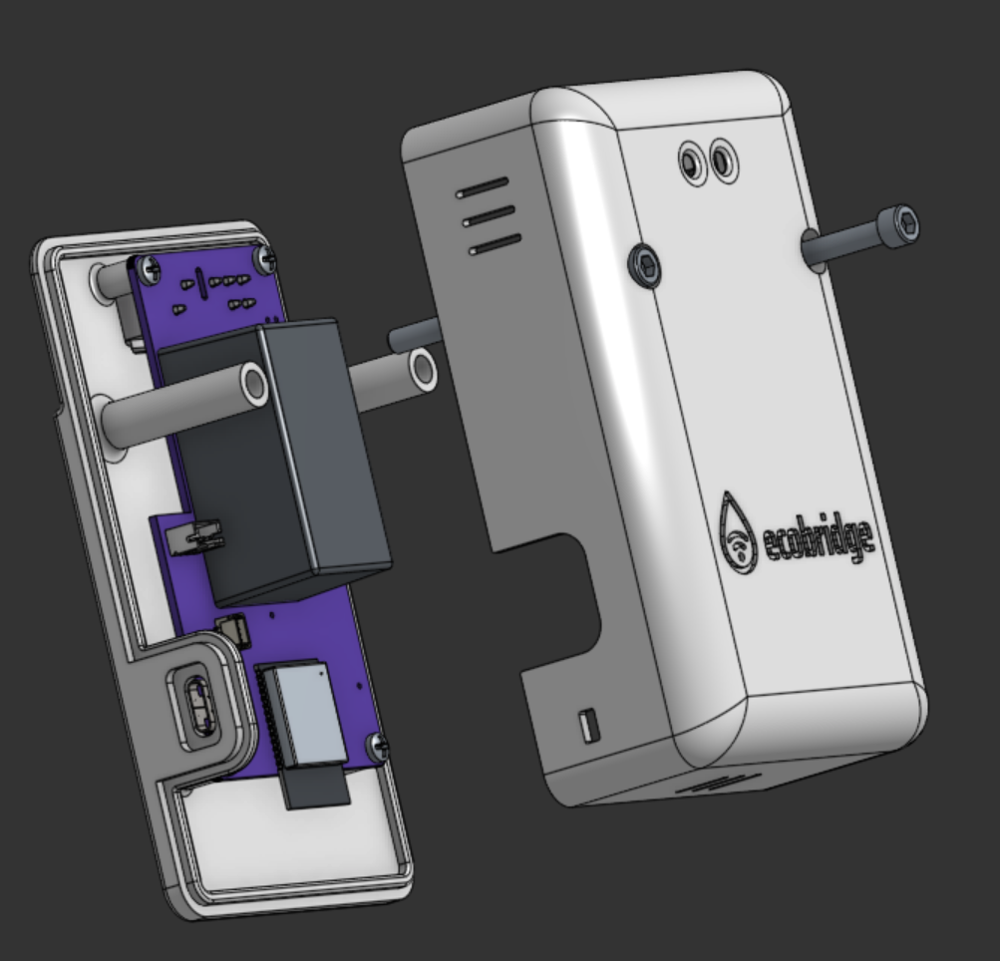

# EcoPort Bridge

EcoPort Bridge is a hobby reverse-engineering and hardware project to build a
communication bridge for appliances using the **CTA-2045 "EcoPort"** interface
(AC-form-factor UCM connector, RS-485 @ 19,200 baud) — starting with a
**Rinnai REHP65** heat pump water heater (CTA-2045-B / SGD, connector CN50,
physical connector part `420B2V12FL0`).

The goal is to expose the appliance's CTA-2045 data (tank temperature,
setpoint, operating state, energy, demand-response/shed status, faults, etc.)
to home automation systems (MQTT, Matter, Home Assistant) via a small
ESP32-class bridge device, built on top of a Python implementation of the
CTA-2045 protocol.



*Rev A: ESP32-C6 board with an on-board mains supply, plugged straight into
the heater's CTA-2045 connector. See [`hardware/rev-a`](hardware/rev-a) for
the board and [`hardware/enclosure`](hardware/enclosure) for the 3D-printed
case.*

## Design principles

- **Generic CTA-2045 core, separate from appliance-specific logic.** The
  `cta2045` layer implements the protocol (framing, messages, CRC, link,
  Basic DR / Intermediate messages). Appliance-specific behavior (e.g. Rinnai
  REHP65 quirks and capability mappings) lives under `appliances/rinnai` (or
  `appliance/rinnai` in firmware) so other CTA-2045/EcoPort appliances can be
  supported later without untangling Rinnai assumptions from the protocol
  implementation.
- **Protocol reverse engineering is kept separate from electrical reverse
  engineering.** Most of the protocol can be worked out via the EPRI UCM
  simulator without ever touching the heater.
- **Facts vs. hypotheses are recorded separately** in `docs/protocol.md` and
  per-capture notes, so reverse-engineering guesses don't quietly turn into
  "the spec" later.
- **Captures are first-class project artifacts.** Raw captures + notes live
  under `captures/` as a reproducible dataset, not a pile of Wireshark
  screenshots.

## Architecture

```text
                   ┌───────────────────────────────┐
                   │       Your application        │
                   │ Home Assistant / MQTT / etc.  │
                   └───────────────┬───────────────┘
                                   │
                         Python CTA-2045 API
                                   │
                   ┌───────────────▼───────────────┐
                   │       CTA-2045 protocol       │
                   │ link + Basic DR + Intermediate│
                   └───────────────┬───────────────┘
                                   │
                              RS-485 UART
                                   │
                   ┌───────────────▼───────────────┐
                   │       Isolated RS-485         │
                   │       transceiver             │
                   └───────────────┬───────────────┘
                                   │
                         CTA-2045 AC connector
                                   │
                   ┌───────────────▼───────────────┐
                   │       Rinnai REHP65           │
                   │          SGD / CN50           │
                   └───────────────────────────────┘
```

## Hardware notes (confirmed)

- Physical connector: `420B2V12FL0` (EPRI's "UCM Connector")
- Only pins **1 (D-), 7 (D+), 8 (GND)** are used; all other pins are left
  unconnected.
- EPRI documents 19,200 baud, 8 data bits, 1 stop bit, no parity.
- This is a mains-adjacent AC-form-factor interface — treat it with a
  deliberate electrical isolation strategy (isolated USB/RS-485 adapter).

See `docs/hardware.md` and `docs/protocol.md` for details, and `captures/`
for recorded traffic.

## Repository layout

```text
ecoport-bridge/
│
├── README.md
├── LICENSE             # AGPL-3.0 (software); hardware/LICENSE is CERN-OHL-S-2.0
├── CONTRIBUTING.md
│
├── docs/                 # architecture, hardware, protocol, HOWTOs
├── hardware/             # PCB revisions + 3D-printed enclosure
├── firmware/             # ESP32 bridge firmware (PlatformIO)
├── python/               # ecoport Python package (protocol + tooling)
├── tools/                # CLI tools: sniff, decode, query, interactive
├── captures/             # recorded protocol traffic + notes (EPRI + Rinnai)
├── test/                 # cross-cutting test fixtures/integration tests
└── scripts/              # dev setup / flashing helpers
```

## Status

Early planning / hardware on order. See `docs/reverse-engineering.md` and
`captures/` as the project progresses.

## Documentation

- [`docs/architecture.md`](docs/architecture.md) — software layering and the device ↔ Azure cloud architecture (telemetry, commands, storage, dashboard, security)
- [`docs/hardware.md`](docs/hardware.md) — connector, pinout, safety, bring-up hardware
- [`docs/protocol.md`](docs/protocol.md) — CTA-2045 protocol facts, capability matrix
- [`docs/capabilities.md`](docs/capabilities.md) — what we can see, infer, log and control on the Rinnai REHP65
- [`docs/reverse-engineering.md`](docs/reverse-engineering.md) — staged plan (EPRI oracle → passive capture → queries → writes)
- [`docs/references.md`](docs/references.md) — source material, tools, and libraries (EPRI, `python-cta2045`, ANSI, EcoPort DB, OpenADR, connector part numbers)
- [`docs/troubleshooting.md`](docs/troubleshooting.md) — common issues

## License

Both licenses are copyleft: you can use, modify and share this project, and
anything you distribute that's based on it has to stay under the same terms.

- **Software** (`firmware/`, `python/`, `tools/`, `scripts/`, `test/`) —
  GNU Affero General Public License v3.0 (`AGPL-3.0-only`), see
  [LICENSE](LICENSE).
- **Hardware** (`hardware/`: KiCad board, footprints, fab outputs, enclosure
  CAD) — CERN Open Hardware Licence v2, Strongly Reciprocal
  (`CERN-OHL-S-2.0`), see [hardware/LICENSE](hardware/LICENSE).
- **Docs and captures** — AGPL-3.0, same as the software.

Source location for the hardware (CERN-OHL-S §1.9):
<https://github.com/jrowe88/ecoport-bridge>. It is also printed on the board.
