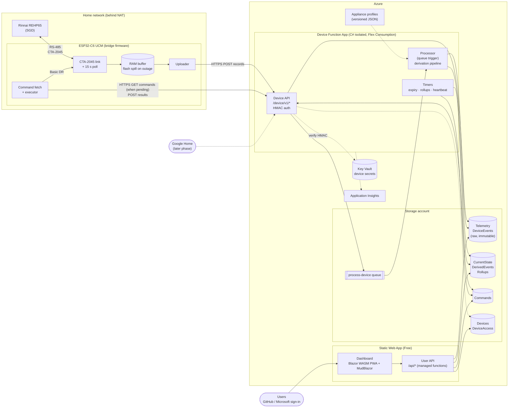
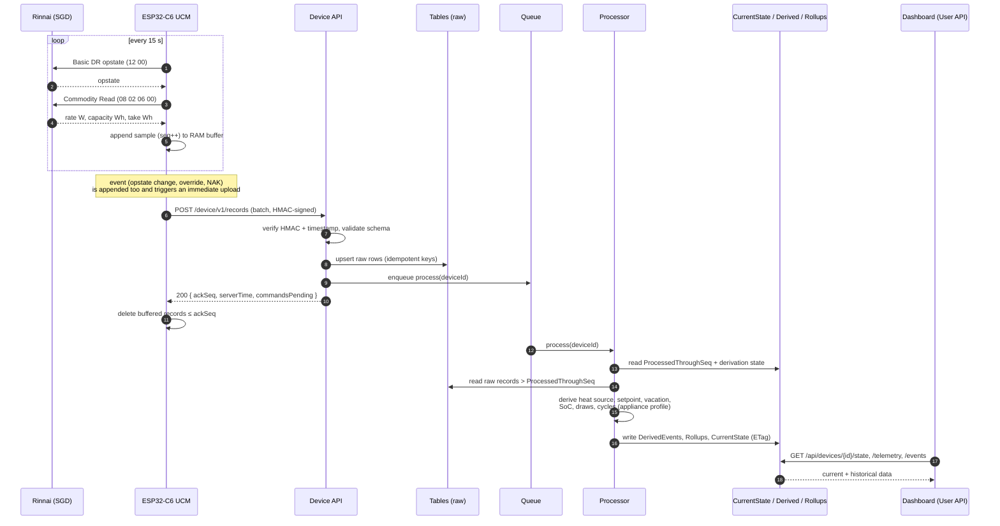
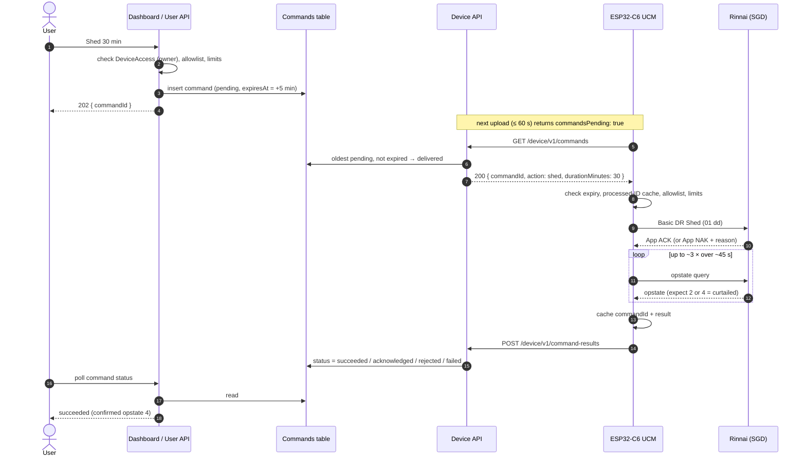
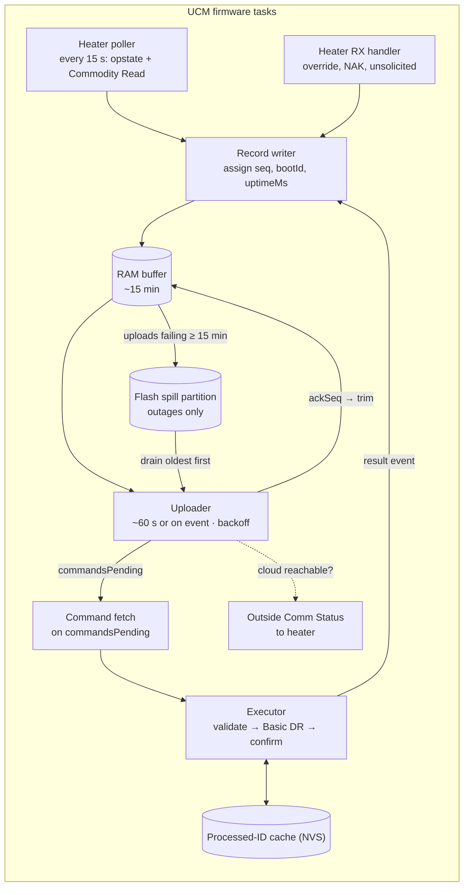
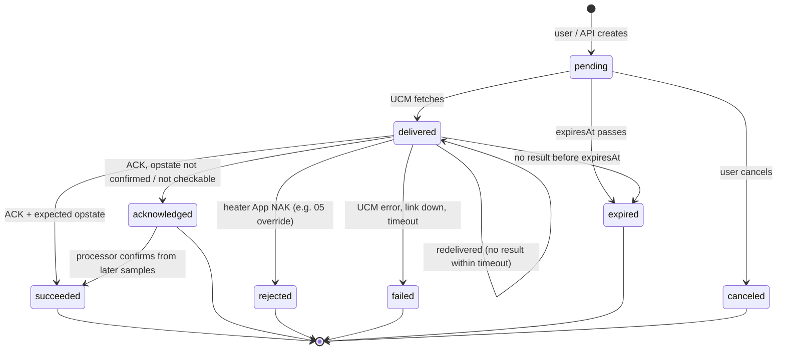

# Architecture

EcoPort Bridge has two parts:

1. **The bridge (UCM).** An ESP32-C6 plugged into the heater's CTA-2045 port.
   It talks to the appliance, buffers readings, and connects out to the cloud.
2. **The cloud service.** A low-cost Azure backend that stores history, derives
   insights, serves a multi-user web dashboard, and queues commands for the
   bridge.

This document covers both: the software layering (section 1) and the
device ↔ cloud system design (sections 2 onwards).

> **Status:** milestone 1 (bench reporting) is running in Azure: an ESP32-C6
> devkit replays recorded Rinnai data and uploads it to the Device API, and
> the Blazor dashboard shows it. CTA-2045 polling, derivation and commands are
> not built yet (section 14). The data model
> uses the fields the Rinnai REHP65 actually exposes today (see
> [`capabilities.md`](capabilities.md)). New fields may be added later without
> changing this architecture.

---

## 1. Software layering

The protocol and appliance code is organized in five layers, from the
electrical interface up to integrations:

```text
                    ECOport Bridge
                         │
          ┌──────────────┴──────────────┐
          │                             │
     CTA-2045 core                 Appliance layer
          │                             │
          │                    ┌────────┴─────────┐
          │                    │                  │
          │                 Rinnai            Other SGD
          │                    │
          └───────────┬────────┘
                      │
                  Transport
                      │
                 RS-485 / USB
```

1. **Transport.** Physical RS-485 UART, isolated transceiver, and byte-level
   framing. See `python/src/ecoport/transport/` and `firmware/ucm/src/rs485.rs`.
2. **CTA-2045 core (protocol).** Generic CTA-2045 link layer, Basic DR and
   Intermediate message types, CRC and enums. It has no appliance-specific
   knowledge. See `python/src/ecoport/cta2045/` and the `firmware/cta2045/`
   crate.
3. **Appliance layer.** Appliance-specific capability mappings and quirks
   (e.g. Rinnai REHP65). See `python/src/ecoport/appliances/rinnai/` and a
   future `firmware/rinnai/` crate.
4. **Bridge / network.** Wi-Fi, time sync, HTTPS client, the local record
   buffer and device identity. See `firmware/ucm/src/`.
5. **Integrations.** Outward-facing publishers. The **cloud integration**
   (section 2 onwards) comes first. Local MQTT / Home Assistant / Matter is an
   optional later add-on, also in `firmware/ucm/src/`.

The firmware is **Rust on ESP-IDF** (`std`, using the `esp-idf-svc` crates),
not bare-metal Rust and not C++. The protocol and appliance crates have no
ESP-IDF dependency, so they build and run their tests on a PC
(see [`firmware/README.md`](../firmware/README.md)).

Keeping the CTA-2045 protocol free of Rinnai assumptions means a second
EcoPort appliance (e.g. another manufacturer's CTA-2045 water heater) can be
added as a new `appliances/<vendor>` module without touching the protocol core.
The cloud has the same split: each appliance model gets an **appliance
profile** (section 6.4) that holds its calibration and derivation rules.

---

## 2. System overview



The UCM opens every connection. Nothing in Azure connects to the device.

### 2.1 Design principles

1. **The UCM is authoritative for the physical heater.** It is the only thing
   that talks CTA-2045, and it enforces its own safety limits.
2. **Keep the UCM thin.** The firmware reads, buffers, publishes, polls and
   reacts. It sends **raw CTA-2045 values** plus cheap facts it already has.
   Anything that can be derived later is derived **in the cloud**, because
   cloud algorithms are easy to change and firmware is not.
3. **Outbound connections only.** The UCM opens every connection, so there is
   no inbound port, NAT setup or public device endpoint.
4. **Raw data is immutable. Derived data can be rebuilt.** When an algorithm or
   calibration changes, derived tables can be regenerated from the raw records.
5. **A command is only a request** until the heater confirms it (App ACK plus
   the expected opstate).
6. **Survive outages without wearing out flash.** Records are held in RAM and
   written to flash only when uploads keep failing. Commands expire. The
   heater falls back to normal operation on its own, and the panel always works.
7. **Stay cheap and simple** for a few devices across a few households, with a
   clear path to scale (section 12).

### 2.2 Decisions

| Topic | Decision |
|---|---|
| Device ↔ cloud transport | HTTPS POST (records, results). Commands are fetched only when an upload response says `commandsPending`; there is no separate command polling. No MQTT, IoT Hub or long polling in v1 |
| Firmware | Rust `std` on ESP-IDF (`esp-idf-svc`). Protocol code in host-testable crates |
| Where derivation happens | Cloud, on intake (asynchronous processor). UCM sends raw values |
| Telemetry cadence | Sample every 15 s, upload a batch every ~60 s, upload immediately on significant events |
| Device buffering | RAM first. Spill to a flash partition only after uploads have failed for ~15 min (section 3.2) |
| Storage | Azure Table Storage (plus a Storage Queue) |
| Backend | Azure Functions, C# (.NET isolated worker) |
| Dashboard | Blazor WebAssembly + MudBlazor, installable as a PWA, on Azure Static Web Apps with built-in auth |
| Phone app | None in v1. The dashboard PWA covers phones. Wi-Fi setup uses Espressif's ESP BLE Provisioning app |
| Tenancy | Multi-user: many users and devices, with access granted per device |
| Automation (TOU / solar / DR schedules) | Deferred. Manual commands only in v1, but the design leaves room (section 13) |
| Local MQTT / Home Assistant | Optional later integration. The cloud is primary |
| Google Home | Later phase, designed for but not built first |
| Infrastructure as code | Bicep |
| Cost target | Free grants wherever possible. Personally funded, so every paid resource needs a reason |

### 2.3 End-to-end flows

**Telemetry: from the heater to the dashboard**



**Command: from a user to the heater and back**



If the result is lost, the command is delivered again after the redelivery
timeout. The UCM finds the ID in its cache and **re-reports** the result
without running the command again.

---

## 3. UCM (bridge firmware) responsibilities

Target hardware is the **ESP32-C6-WROOM-1-N8** on the rev-A bridge board. The
firmware is Rust on ESP-IDF; see [`firmware/README.md`](../firmware/README.md)
for the crate layout, pin map and build setup.

The firmware only does these things:

| Responsibility | Notes |
|---|---|
| CTA-2045 link | Handshake, max-payload negotiation, App ACK/NAK, echo filtering. Ported from `tools/ucm.py` |
| Poll the heater | Every 15 s: Basic DR opstate (`12 00`) and Commodity Read (`08 02 06 00`). GetInformation (`01 01`) at boot and when the link (re)connects |
| Notice heater-initiated messages | e.g. Customer Override (`11 xx`), unsolicited NAKs. Record them as events |
| Buffer records | In RAM, spilling to flash only during a long outage (section 3.2) |
| Upload | Batched HTTPS POST, oldest first, deleted only after the server acknowledges them |
| Fetch and execute commands | When an upload response says `commandsPending`: fetch, validate, send Basic DR, confirm through opstate, report the result |
| Report outside comm status | Send CTA-2045 *Outside Communication Connection Status* to the heater so it knows whether the UCM has cloud connectivity |
| Health | Wi-Fi RSSI, uptime, free heap, reset reason, buffer depth, link error counters |

It deliberately **does not** do any of these: setpoint calibration, heat-source
classification beyond simple flags, state-of-charge, draw detection, energy
integration, scheduling or rollups.



### 3.1 Record types

The UCM produces a single stream of **records**. Every record gets the next
value of a **persistent sequence number**: a 32-bit counter that keeps
increasing across reboots. The counter itself lives in RAM. NVS only stores a
reserved high-water mark, written once per block of 1,024 sequence numbers
(about every 4 hours), and on boot the counter starts at that mark. A reboot
can therefore leave a gap in the sequence, which the cloud accepts.

| Kind | When | Raw content |
|---|---|---|
| `sample` | Every 15 s | Opstate, Commodity Read fields, link quality |
| `event` | When it happens | Opstate change, Customer Override, App NAK, link lost or restored, boot, time sync, heater info (GetInformation) |
| `health` | Every ~5 min and at boot | RSSI, heap, uptime, reset reason, buffer depth, firmware version |

### 3.2 Local buffer

Normally the device never writes telemetry to flash. Uploads succeed every
~60 s, so only a handful of records are ever waiting.

- **RAM first.** Records wait in a RAM queue until the server acknowledges
  them. Records are compact binary, about 32 B for a sample, so 15 minutes
  (60 samples plus events) is only a few KB.
- **Spill to flash only during an outage.** When the oldest unacknowledged
  record is more than **15 minutes** old (uploads have kept failing), the RAM
  queue is written to a ring buffer in its own flash partition in one batch,
  and again every 15 minutes while the outage lasts. At 5,760 samples/day, a
  1 MB partition holds about five days. The 15-minute threshold is a
  configuration value.
- **Drain order.** When uploads work again, the flash spill is drained first
  (oldest first), then the RAM queue, so the server still sees records in
  sequence order. The spill partition is erased once it is fully acknowledged.
- **Tradeoff.** A power cut or crash loses whatever was only in RAM: normally
  under a minute of data, and at most ~15 minutes during an outage. That is
  acceptable for telemetry. The command processed-ID cache is still kept in
  NVS (section 5.3), because losing it could re-run a command.
- Each record stores `bootId` and `uptimeMs`. The device converts these to
  UTC when it uploads, using the SNTP offset for that boot. Uploading needs a
  network connection, and SNTP syncs as soon as there is one. Records from a
  boot that never synced time are uploaded with `timeQuality: "unsynced"`. The
  cloud keeps them but leaves them out of time-based analysis.
- When the spill partition is full, the oldest `sample` and `health` records
  are dropped before any `event` records.
- Records are removed only up to the `ackSeq` that the server returns.

### 3.3 Upload cadence

- Normally, upload one batch about every 60 s (about four samples, plus any
  events).
- Upload **right away** when an event is recorded (opstate change, override or
  command result), so the dashboard reacts within seconds.
- After an outage, drain the buffer oldest first in chunks of up to 100
  records. Leave a short gap between chunks.
- On failure, back off exponentially with jitter (cap ~5 min). Keep sampling
  the whole time.
- The upload response is also the command channel: `commandsPending: true`
  makes the device fetch commands right away. Command latency is therefore up
  to ~60 s, which is fine for a water heater and removes ~75% of device API
  calls compared with a separate 20 s poll.

---

## 4. Device API

All device endpoints are on the **Device Function App**, are versioned under
`/device/v1/`, and require HMAC authentication (section 9.1).

### 4.1 Upload records

```http
POST /device/v1/records
Content-Type: application/json
X-Device-Id: WH001
X-Timestamp: 2026-10-09T20:31:02Z
X-Signature: <base64 HMAC-SHA256>
```

```json
{
  "deviceId": "WH001",
  "bootId": "c4e633a2",
  "firmware": "0.3.0",
  "records": [
    {
      "seq": 12783,
      "kind": "sample",
      "t": "2026-10-09T20:30:00.120Z",
      "opState": 1,
      "commodity": {
        "electricityRateW": 268,
        "electricityCumulativeWh": 0,
        "totalStorageCapacityWh": 12011,
        "presentEnergyTakeWh": 1450
      },
      "link": { "ok": true, "retries": 0, "naks": 0 }
    },
    {
      "seq": 12784,
      "kind": "event",
      "t": "2026-10-09T20:30:07.880Z",
      "type": "opStateChanged",
      "data": { "from": 1, "to": 0 }
    }
  ]
}
```

Notes:

- The `commodity` object stores the CTA-2045 Commodity Read values exactly as
  received, keyed by commodity type, so the cloud keeps everything the heater
  reports. That includes fields that are always 0 today, such as
  `electricityCumulativeWh`.
- Fields the heater does not provide (tank temperature, setpoint, mode, faults)
  are **not** sent. Setpoint and mode are derived in the cloud. If later
  research finds a direct source, it is added as a new optional field.
- Optional `raw` hex frames can be attached to events for unrecognized
  messages, for remote reverse engineering. This is off by default and turned
  on per device.

Response:

```json
{ "ackSeq": 12784, "serverTime": "2026-10-09T20:31:02.410Z", "commandsPending": true }
```

- `ackSeq` is the highest sequence number for which **this record and every
  earlier record in the request** has been stored. The device can then delete
  those records.
- `commandsPending` tells the device to fetch commands now. It is the only
  trigger for fetching commands.
- `serverTime` lets the device spot clock drift.

Server steps: authenticate, validate the schema, upsert the raw rows
(idempotent; section 7), enqueue a `process(deviceId)` message, update
`LastSeen`, then respond. **No derivation happens inside the request.** That
keeps device calls quick and reliable.

### 4.2 Fetch commands

```http
GET /device/v1/commands
```

The UCM calls this only after an upload response with
`commandsPending: true`. It does not poll on a timer. If a fetch fails, the
next upload response repeats `commandsPending`, so nothing is lost.

- `204 No Content`: nothing is pending.
- `200`: returns the oldest command that is still `pending` and not expired.
  The server marks it `delivered` and records `deliveredAt`. If no result
  arrives within a redelivery timeout (e.g. 2 min), the same command is
  delivered again. The UCM's processed-ID cache makes this safe.

```json
{
  "commandId": "01J9V6WR9M6P8Q2T1XK4H3B7ZD",
  "action": "shed",
  "parameters": { "durationMinutes": 30 },
  "createdAt": "2026-10-09T20:31:00Z",
  "expiresAt": "2026-10-09T20:36:00Z"
}
```

### 4.3 Report command result

```http
POST /device/v1/command-results
```

```json
{
  "commandId": "01J9V6WR9M6P8Q2T1XK4H3B7ZD",
  "status": "succeeded",
  "heaterResponse": { "type": "appAck", "opcode": "0x01" },
  "confirmedOpState": 4,
  "completedAt": "2026-10-09T20:31:21Z"
}
```

This is idempotent by `commandId`. The UCM also records the result as an
`event`, so it appears in the timeline even if this call is lost.

---

## 5. Commands

### 5.1 Supported actions (v1)

The only control the heater offers is **CTA-2045 Basic DR** (see
[`capabilities.md` §4](capabilities.md)). Setpoint, mode and vacation **cannot**
be changed over CTA-2045 on the Rinnai, so they are not commands.

| Action | Basic DR | Parameters | Expected confirmation (opstate) |
|---|---|---|---|
| `shed` | `01 dd` | `durationMinutes` | 2 or 4 (curtailed) |
| `endShed` | `02 00` | — | 0 or 1 (normal) |
| `loadUp` | `17 dd` | `durationMinutes` | 3 or 6 (heightened) |
| `criticalPeak` | `0A dd` | `durationMinutes` | 2 or 4 |
| `gridEmergency` | `0B dd` | `durationMinutes` | 2 or 4 |
| `powerLevel` | `06 pp` | `percent` | App ACK only (no opstate signature known) |

The duration is encoded as `dd = ceil(sqrt(seconds / 2))`.

The **confirmation column is a hypothesis** until the control test in
`capabilities.md` §4 has run. The confirmation rules live in the cloud's
appliance profile. The UCM only reports what it saw (ACK/NAK and opstate), so
the rules can be corrected without a firmware change.

Price messages (`07`/`08`/`09`) are left out until there is a reason to add
them.

### 5.2 Validation (both sides)

| Check | Cloud | UCM |
|---|---|---|
| User may control this device | ✔ (`owner` role) | — |
| Action is on the allowlist | ✔ | ✔ |
| Duration 1–120 min; every event command has a duration | ✔ | ✔ (hard limit) |
| Not expired (`expiresAt`, default 5 min after creation) | ✔ | ✔ |
| Not already processed | — | ✔ (persistent cache of recent IDs and results) |

### 5.3 Execution on the UCM

1. Check expiry, the processed-ID cache and the allowlist with its limits.
2. Send the Basic DR message and wait for the App ACK or NAK.
3. If ACKed, query opstate again (up to ~3 tries over ~45 s).
4. Report the result. Put the ID and result in the persistent cache. If the
   same command is delivered again, the cached result is re-reported and the
   command is **not** re-executed.

### 5.4 Status lifecycle



The cloud can **re-check a result** later. For example, it can upgrade
`acknowledged` to `succeeded`, or flag an early end, by comparing the result
with the opstate samples that follow. That check is done by the processor.

### 5.5 Safety

- Every event command has a bounded duration, so it ends even if End Shed is
  lost.
- If the UCM stops talking to the heater, the CTA-2045 fallback returns the
  heater to normal.
- The UCM tells the heater when it loses cloud connectivity (*Outside Comm
  Status*).
- The panel override always works. Overrides show up as `customerOverride`
  events and as opted-out opstates.

---

## 6. Cloud processing (derivation on intake)

### 6.1 Flow

```text
POST /records ─► upsert raw ─► enqueue process(deviceId) ─► 200 ackSeq
                                       │
                                       ▼
         Processor (queue trigger, one device at a time via ETag)
           1. Read CurrentState.ProcessedThroughSeq
           2. Read raw records > that seq, in seq order
           3. Run the appliance-profile derivation pipeline
           4. Write DerivedEvents + Rollups
           5. Update CurrentState (ETag-guarded) incl. ProcessedThroughSeq
```

- The queue message only **wakes the processor up**. The processor reads raw
  data from tables, so out-of-order or duplicate messages do no harm.
- If two processors run for the same device, ETag concurrency on
  `CurrentState` stops both from committing. The one that loses retries.
- Derivation is **stateful**. Draw detection, for example, needs the previous
  samples. That state is kept in `CurrentState.DerivationStateJson`.

### 6.2 Derived values

These are based on today's capabilities (see `capabilities.md` §2):

| Derived value | Source | Stored in |
|---|---|---|
| Heat source (off / compressor / element / both) | `electricityRateW` bands | CurrentState, Rollups |
| Setpoint (°F) | `totalStorageCapacityWh` and the profile's calibration table | CurrentState, DerivedEvents (on change) |
| Vacation | Commodity Read returns all zeros | CurrentState, DerivedEvents |
| State of charge (%) | 1 − take ÷ capacity | CurrentState, Rollups |
| Hot water draws (time, estimated kWh) | Jumps in take | DerivedEvents |
| Heating cycles (start, end, source minutes, estimated kWh) | Opstate and rate transitions | DerivedEvents, Rollups |
| Estimated energy (kWh by source) | Rate integrated over time | Rollups |
| Inferred panel mode | Heat-source pattern during recovery | CurrentState (with confidence) |
| DR event outcome | Command, opstate and rate after it, overrides | DerivedEvents |
| Connectivity (online / delayed / offline) | `LastSeen` against configurable thresholds | Computed at read time |

Each derived row records `derivationVersion` and `profileVersion`.

### 6.3 Reprocessing

If an algorithm or calibration changes, an admin-triggered job resets
`ProcessedThroughSeq` (or picks a time range), deletes the derived rows for
that range, and runs the processor again. Raw data is never modified.

### 6.4 Appliance profiles

A profile holds the per-model rules and is keyed by the GetInformation data
(vendor `0x0C22`, device type HPWH, revision):

- Calibration from capacity to setpoint (lookup table; not linear)
- Electricity-rate bands for classifying the heat source
- Opstate confirmation rules for commands
- Thresholds for draw and cycle detection

Profiles are versioned JSON files kept in the repo (`cloud/profiles/`) and
deployed with the Function App. A device may override part of its profile, for
example its own calibration.

### 6.5 Golden tests

The derivation code is ported from the Python research tools (such as
`tools/ucm_timeline.py`) to C#. The captures in `captures/rinnai/` become test
fixtures: replay a capture through the C# pipeline and check the expected
heating cycles, draws, setpoint and vacation transitions.

---

## 7. Storage (Azure Table Storage)

One storage account holds all the tables below, plus one queue
(`process-device`).

| Table | PartitionKey | RowKey | Purpose |
|---|---|---|---|
| `Devices` | `DEVICE` | `{deviceId}` | Registry: claim-code hash, secret version, heater info, firmware, `LastSeen`, created/claimed dates |
| `DeviceAccess` | `{userId}` | `{deviceId}` | Grants a user a role (`owner` / `viewer`) on a device |
| `DeviceAccessByDevice` | `{deviceId}` | `{userId}` | Reverse lookup, used for sharing and admin |
| `Telemetry` | `{deviceId}_{yyyyMMdd}` | `{HHmmssfff}_{seq:D10}` | Raw `sample` records (immutable) |
| `DeviceEvents` | `{deviceId}` | `{yyyyMMddTHHmmssfff}_{seq:D10}` | Raw `event` and `health` records (immutable) |
| `CurrentState` | `DEVICE` | `{deviceId}` | Latest raw and derived values, `ProcessedThroughSeq`, `DerivationStateJson`, active DR event and expiry |
| `DerivedEvents` | `{deviceId}` | `{yyyyMMddTHHmmss}_{type}_{seq}` | Heating cycles, draws, setpoint, vacation and mode changes, DR outcomes |
| `Rollups` | `{deviceId}_H` / `{deviceId}_D` | `{yyyyMMddHH}` / `{yyyyMMdd}` | Hourly and daily stats: heat-source minutes, estimated kWh, draws, min/avg/max SoC |
| `Commands` | `{deviceId}` | `{ULID}` | Command, parameters, status, timestamps, `RequestedBy`, result JSON |

Notes:

- **Idempotent writes.** Raw row keys are built only from record contents
  (time and seq), so if the device retries, the upsert writes the same row.
  Table batch transactions (up to 100 entities in one partition) cover a
  typical upload.
- **Daily telemetry partitions** let a one-day chart come from one partition
  query. Longer ranges read `Rollups`.
- **Volume.** About 5,760 samples per device per day, roughly 2 M rows per
  year. That is a few hundred MB per device per year, which costs pennies in
  Table Storage. Raw data is kept indefinitely in v1, and a retention policy
  can be added later.
- **Tenant isolation** is enforced in the User API by checking `DeviceAccess`
  on every request. Partitions are per device, not per tenant, because devices
  can be shared.

---

## 8. User API and dashboard

### 8.1 Hosting

- **Azure Static Web Apps (Free plan)** hosts the dashboard and the **User
  API** as managed Functions (C# isolated, HTTP only). Its built-in auth
  (GitHub and Microsoft accounts) fills in `x-ms-client-principal`.
- The dashboard is a **Blazor WebAssembly** app using **MudBlazor**
  components. It is a static site, so it fits SWA Free, and it is built as an
  installable **PWA** so it works as the phone app too. A first visit
  downloads the .NET runtime (a few MB, then cached).
- A **separate Function App** (Flex Consumption) hosts the Device API, the
  queue processor and timers. Device traffic never goes through SWA auth, and
  the two can be scaled, secured and deployed separately.
- All C# projects share libraries: `EcoPort.Cloud.Contracts` (API request and
  response types, used by the Blazor app as well as the Functions) and
  `EcoPort.Cloud.Core` (table access and derivation).

> Alternative: SWA **Standard** with a linked backend would put everything in
> one Function App. It costs about $9/month per app. This is worth switching to
> if custom auth providers (e.g. Entra External ID for Google Home account
> linking) are needed.

### 8.2 Endpoints

```http
GET    /api/me                                     # profile + devices I can access
POST   /api/devices/claim                          # { claimCode } -> become owner
GET    /api/devices/{id}/state                     # CurrentState (raw + derived + connectivity)
GET    /api/devices/{id}/telemetry?from&to&res     # raw (≤1 day) or Rollups (longer); server-side downsampling
GET    /api/devices/{id}/events?from&to&types      # DerivedEvents + selected raw events
GET    /api/devices/{id}/rollups?from&to&grain=H|D
POST   /api/devices/{id}/commands                  # owner only
GET    /api/devices/{id}/commands?status&from
GET    /api/devices/{id}/commands/{commandId}
POST   /api/devices/{id}/commands/{commandId}/cancel
POST   /api/devices/{id}/access                    # owner shares (viewer/owner) — later
```

### 8.3 Dashboard (v1)

- **Now:** heat source, power (W), stored energy (%), setpoint (°F, derived),
  vacation, opstate, active DR event and time left, last contact.
- **Charts:** power and heat source over time, stored energy, and draw and
  heating-cycle markers.
- **Daily:** element minutes and estimated kWh (the main efficiency alert),
  compressor hours, and draws.
- **Control:** Shed, Load Up, End Shed (and other DR actions) with a duration,
  plus command history and status.
- **Caveats:** estimated and inferred values are labelled as such.

---

## 9. Identity and security

### 9.1 Device authentication

- Each device has a unique `deviceId` and a **256-bit secret**, set when it is
  provisioned. The secret is stored in NVS on the device (encrypted NVS if
  practical) and in **Key Vault** on the server. The server caches secrets in
  memory for a short time.
- Every request is signed:
  `HMAC-SHA256(secret, method \n path \n X-Timestamp \n SHA256(body))`.
- The server rejects a timestamp more than ±5 min from its own clock. Within
  that window, a replay does no harm because every endpoint is idempotent
  (records by seq, results by commandId, and polling is read-only). This
  avoids storing nonces. A nonce can be added if a non-idempotent device
  endpoint ever appears.
- **Rotation:** the `Devices` row stores the current and previous secret
  versions. The server accepts both while a rotation is in progress. The new
  secret is delivered over the authenticated channel (as a `rotateSecret`
  system command) and is confirmed before the old one is retired.
- The device never gets storage keys or any general Azure credential, and it
  never writes to storage directly.
- *Alternative considered:* per-device X.509 client certificates (mTLS). They
  are stronger, but harder to provision and rotate on the ESP32 and in
  Functions. Revisit when moving to IoT Hub or Event Grid MQTT.

### 9.2 Provisioning and claiming (multi-user)

1. **Provision (admin or bench script):** generate `deviceId`, the secret and a
   one-time **claim code**. Write the secret to Key Vault. Write the `Devices`
   row with the claim code hashed. Flash the ID and secret to NVS. Print the
   claim code on a label or show it on the serial console.
2. **Wi-Fi onboarding:** ESP-IDF Wi-Fi provisioning over BLE, using
   Espressif's free **ESP BLE Provisioning** app (iOS and Android). No custom
   phone app is needed.
3. **Claim:** the user signs in and enters the claim code. The server writes
   the `DeviceAccess` rows (owner) and marks the code as used.
4. **Unclaim / transfer:** the owner releases the device, or an admin resets
   it. A new claim code is generated.

### 9.3 User authentication and authorization

- SWA built-in auth with GitHub and Microsoft. Any user can sign in, but
  access to a device comes only from `DeviceAccess`.
- Roles: `owner` can view, send commands and share. `viewer` can only view.
  There is also an app-level `admin` role, assigned through SWA role
  invitations, for provisioning and reprocessing.
- Every User API handler loads the principal, checks `DeviceAccess` for the
  device in the route, and then reads or writes.

### 9.4 Secrets and configuration

- The Function Apps use **managed identity** for Storage and Key Vault, so
  there are no connection strings with keys.
- HTTPS only, with TLS 1.2 or later. The firmware pins the root CA bundle,
  not a leaf certificate.

---

## 10. Reliability and idempotency (summary)

| Concern | Mechanism |
|---|---|
| Duplicate uploads | Deterministic raw row keys and upsert. Device deletes only up to `ackSeq` |
| Lost upload response | Device retries. Server writes the same rows again |
| Outage (Wi-Fi or cloud) | RAM buffer, spilled to flash after ~15 min of failed uploads. Events are kept before samples. Drained oldest first |
| Reboot without a time source | `bootId` + `uptimeMs`, converted to UTC once synced, otherwise flagged `unsynced` |
| Duplicate command delivery | Persistent processed-ID cache on the UCM. The result is re-reported, not re-executed |
| Lost command result | Result is also recorded as an event. Redelivery timeout. Commands expire |
| Concurrent processors | Queue is only a wake-up. ETag on `CurrentState` |
| Algorithm or calibration bug | Raw data is immutable. Versioned derivation. Reprocessing |
| Device offline | `LastSeen` thresholds (configurable). Shown on the dashboard. Alerting later |

---

## 11. Azure resources and deployment

Bicep (`infra/bicep/`) defines the resources: `main.bicep` plus one parameter
file per environment (`dev.bicepparam`, `prod.bicepparam`), deployed with
`az deployment group create`. Bicep is free and keeps no state file, so there
is no state storage to pay for or secure. Each environment creates:

- Resource group
- Storage account: the tables and queue listed in section 7
- Function App (Flex Consumption, .NET isolated) with a system-assigned
  managed identity, holding the Device API, the processor and timers
- Static Web App (Free) with managed Functions for the User API
- Key Vault (RBAC mode) for device secrets
- Application Insights and a Log Analytics workspace (with a daily cap)
- Role assignments: Function App → Storage Table/Queue Data Contributor and
  Key Vault Secrets Officer. SWA managed functions cannot use a managed
  identity, so the User API gets a connection string carrying an account SAS
  limited to the **Table service, read + list, HTTPS, 1-year expiry**,
  reissued on every infrastructure deployment. It cannot write or reach blobs
  and queues. When the User API needs to write (commands, M2), add a separate
  SAS scoped to the `Commands` table only.

Timers on the Function App:

- Expire stale `pending` / `delivered` commands
- Daily rollups and fixing up late data
- Heartbeat sweep (marks devices offline, used for future alerts)

CI/CD (GitHub Actions): build and test the .NET projects, run
`az deployment group what-if` on PRs, deploy the infrastructure, Function App
and SWA when `main` changes. Each workflow runs only when its folder changes.

**Cost.** This is paid personally, so the target is to stay inside free
grants:

| Item | Expected use (per device) | Notes |
|---|---|---|
| Device API calls | ~1,440/day (one upload a minute), ~43k/month | Command fetches only happen when commands are pending. Flex Consumption has a monthly free grant of executions and GB-s |
| Table Storage + queue | A few hundred MB/year, ~2 transactions per upload | Pennies a month |
| Static Web Apps | Free plan | Includes the managed User API functions and built-in auth |
| Key Vault | Secret reads, cached in memory | Billed per 10k operations; no fixed fee |
| Application Insights / Log Analytics | The cost most likely to grow | Sampling on, daily cap set, short retention |

Check the current free grants in the Azure pricing calculator before going to
production, and set a **budget alert** on the subscription.

### Repository layout

```text
hardware/                      # board and enclosure (CERN-OHL)
firmware/                      # Rust: cta2045/ (host-testable), ucm/ (ESP-IDF app)
cloud/
  src/
    EcoPort.Cloud.Contracts/   # API types shared with the Blazor app
    EcoPort.Cloud.Core/        # table access, auth, derivation, profiles
    EcoPort.Cloud.Device/      # Function App: Device API, processor, timers
    EcoPort.Cloud.Api/         # SWA managed functions: User API
  profiles/                    # versioned appliance profiles (JSON)
  tests/                       # unit + golden tests (replay captures/)
web/                           # Blazor WASM + MudBlazor dashboard (PWA)
infra/bicep/                   # Azure infrastructure
```

---

## 12. Evolution path

Reconsider the transport and platform when any of these happen:

| Trigger | Option |
|---|---|
| Command latency of up to 60 s is too slow, or request cost grows with the fleet | **Azure Event Grid MQTT broker** (per-device X.509 identity, publish and subscribe) or IoT Hub |
| Many devices, managed provisioning, device twins, fleet OTA | **Azure IoT Hub** + DPS |
| Heavy analytics or long-range queries over raw data | Export raw data to Data Explorer / Fabric, or Parquet in Blob |
| Need for sign-in without GitHub/Microsoft, or Google account linking | Entra External ID with SWA Standard |

The device protocol is versioned (`/device/v1/`) and the firmware keeps the
cloud transport in its own module of the `ucm` app, so changing the transport
does not touch the CTA-2045 or appliance crates.

---

## 13. Later phases (designed for, not built in v1)

- **Automation (TOU / solar / DR schedules).** Preferred model: the cloud
  works out a schedule and sends it as a command (`setSchedule`). The UCM
  stores it and carries it out locally, so it keeps working through outages.
  This adds one action and a small scheduler on the device. The rest of this
  architecture stays the same.
- **Google Home.** Cloud-to-cloud fulfillment on the Device Function App
  (`/google/fulfillment`). It needs an OAuth 2.0 account-linking server
  (Entra External ID), which maps Google users to `DeviceAccess`. Queries read
  `CurrentState`, and commands insert into `Commands` (Shed / Load Up exposed
  as modes). Water-heater temperature control is **not** possible because
  setpoint is read-only.
- **Local MQTT / Home Assistant.** A second publisher in the `ucm` app. It
  publishes the same raw records to a local
  broker, and an optional Home Assistant add-on runs the derivation
  locally.
- **Firmware OTA.** The device reports its firmware version (already in
  `health`). A `/device/v1/firmware` manifest endpoint and signed images in
  Blob storage allow `esp_https_ota` updates, triggered by a system command.
- **Alerts.** Device offline, element use above a threshold, customer override
  during a DR event, unexpected opstate (e.g. 5 SGD Error). Delivered by email
  or push.

---

## 14. Implementation sequence

**Done (M1, 2026-10-25):** bench reporting and collection, per
[`docs/superpowers/plans/2026-10-25-m1-bench-reporting.md`](superpowers/plans/2026-10-25-m1-bench-reporting.md).
The devkit samples a replayed heater every 15 s and uploads signed batches to
`POST /device/v1/records` (raw tables, `CurrentState`; no queue/processor
yet). The dashboard (Blazor + MudBlazor on SWA Free, role `bench`) shows
current state and a 1-day chart, read through a read-only table SAS. Bicep
deploys everything to `rg-ecoport-dev`. Steps below are still open except
where M1 covered part of them (3, 4 without the queue, 6 without claim
codes).

1. Port the CTA-2045 link and the 15 s poll loop to Rust (`firmware/cta2045`,
   tested on a PC against the captures), then run it on the ESP32-C6 (no
   network yet). Framing and checksum are done.
2. RAM record buffer, flash spill, and persistent sequence number.
3. Bicep for the base resources, plus `EcoPort.Cloud.Core` table models.
4. `POST /device/v1/records` with HMAC auth, raw tables and the queue.
5. Processor with heat source, vacation, SoC and setpoint (calibration
   pending), plus golden tests from the captures.
6. Dashboard (Blazor + MudBlazor): sign-in, claim, current state, one-day
   chart.
7. Commands: table, User API, device fetch and result endpoints, UCM execution
   with confirmation. **Run the control test from `capabilities.md` §4 first.**
8. Draws, heating cycles, rollups and daily reports.
9. Hardening: secret rotation, offline detection, App Insights dashboards,
   CI/CD.
10. Later phases (section 13).

## 15. Open questions

- **Opstate signatures for confirming commands**: waiting on the Shed /
  Load Up test.
- **Setpoint calibration table**: waiting on the setpoint sweep.
- Whether to use **encrypted NVS / flash encryption** on the C6 for the device
  secret (affects provisioning workflow).
- **SWA Free** (managed functions use a scoped SAS) or **Standard**
  (linked backend with managed identity, custom auth), once the security and
  cost tradeoff is clearer.
- **Raw retention policy** (indefinite in v1).
